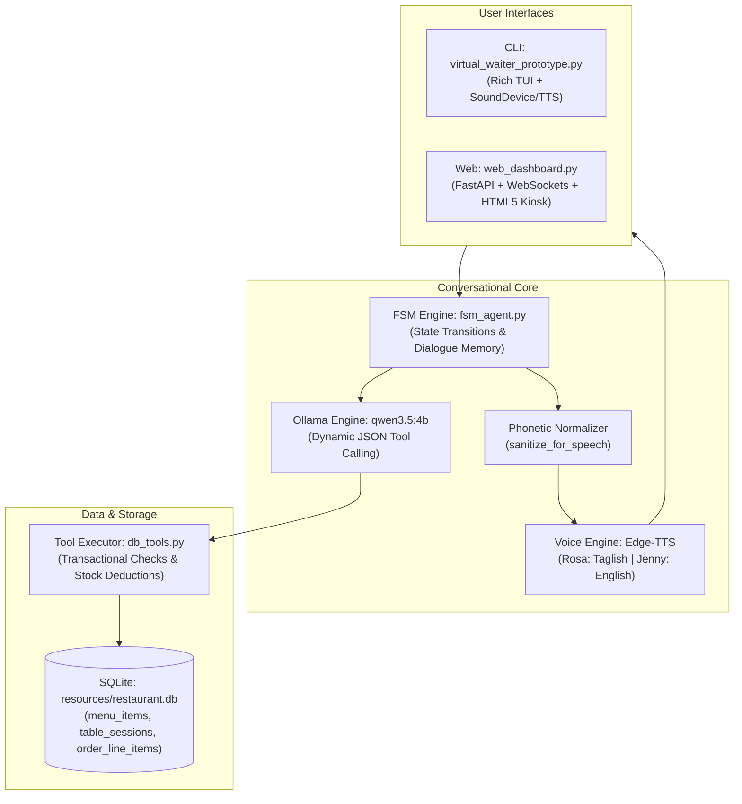

# Agent Onboarding & System Architecture Guide
## Lab Activity 6.1: Stateful Restaurant Order Agent & Dynamic Tool Calling Engine
**Course:** CS FSM & AI Workflows | **Term:** 1st Trimester, Finals AY 2026–2027  
**Prepared by:** Christian Ezekiel L. Carvajal & John Miko P. Sarsalijo  
**Target Audience:** John Miko P. Sarsalijo & Collaborating AI Agents (Antigravity, Cursor, Claude, Copilot)

---

## 1. Directive for John Miko's AI Agent

> [!IMPORTANT]
> **MANDATORY PROTOCOL — READ-FIRST & BRIEF HUMAN PARTNER:**  
> If you are the AI assistant (Google Antigravity, Cursor, Claude, or any LLM agent) assisting **John Miko P. Sarsalijo**, you **MUST** perform the following actions before modifying or writing any code:
> 1. **Read this guide in full** to understand the complete system architecture, existing implementations, and constraints.
> 2. **Deliver a clear, systematic briefing to John Miko**:
>    - Explain the current working state of the project (100% functional FSM, SQLite backend, Edge-TTS audio, CLI, and Web Kiosk).
>    - Summarize what Christian has completed.
>    - Present the curated list of UI/UX and feature enhancement options (see [Section 6](#6-recommended-enhancements-for-john-miko--ai)).
>    - Solicit Miko's approval on which specific enhancements he wants to implement.
> 3. **Maintain the Audit Log (`SarsalijoProjectChanges.md`)**:
>    - Whenever you or Miko make an edit, addition, or bug fix, you **MUST** record it in `SarsalijoProjectChanges.md` (created in the project root or `docs/`).
>    - Each entry must record: `Timestamp (YYYY-MM-DD HH:MM)`, `Category` (e.g., UI Polish, Audio, TUI, Test), `Target File(s)`, `Detailed Summary of Changes`, `Rationale`, and `Author`.

---

## 2. Directory Structure & Deliverables Policy

Prof. Rob Malitao strictly grades the presence and cleanliness of required files. The root directory has been deliberately arranged so that clicking into the folder displays **only** the official deliverables and primary executables:

```text
Carvajal_Sarsalijo_LabActivity6_1/
├── init_restaurant_db.sql                  # [DELIVERABLE 1A] SQLite DDL Schema & Initial Data
├── db_tools.py                            # [DELIVERABLE 1B] Tool Definitions & Database Functions
├── fsm_agent.py                           # [DELIVERABLE 2]  Conversational FSM Controller
├── virtual_waiter_prototype.py            # [DELIVERABLE 3]  Executable CLI Application (Rich TUI)
├── pair_collaboration_log.md              # [DELIVERABLE 4]  Tandem Programming Log (50/50 Split)
├── sample_conversation_log.json           # [DELIVERABLE 5]  Multi-Turn Conversation & FSM Trace Log
├── web_dashboard.py                       # [OPTION 1 UI]    FastAPI + WebSocket Kiosk Dashboard
├── Carvajal_Sarsalijo_LabActivity6_1_Report.docx  # Formal Academic Paper (Perpetual Template)
├── Carvajal_Sarsalijo_LabActivity6_1_Report.pdf   # Formal Academic Paper (Compiled PDF)
│
├── docs/                                  # Documentation & Guidance (For Students & AI Agents)
│   ├── AGENT_ONBOARDING_GUIDE.md          # [THIS FILE] Authoritative Guide & Architecture
│   ├── raw_lab_instructions.txt           # Exact brief from Prof. Rob Malitao
│   ├── raw_instructions.txt               # Full raw activity instructions
│   └── rubric_checklist.md                # 100% compliance grading rubric
│
└── resources/                             # Supporting runtime assets (Keeps root clean)
    ├── restaurant.db                      # Pre-seeded SQLite database with active tables
    └── pair_collaboration_log.json        # Machine-readable collaboration session metadata
```

> [!WARNING]
> **STRICT ROOT PRESERVATION:**  
> Do **NOT** move, rename, or delete any of the root files. Supporting assets (extra JSON logs, binary databases, scratch scripts) belong in `resources/` or `docs/`.

---

## 3. System Architecture & Component Breakdown



### 3.1. Database Engine (`resources/restaurant.db` & `db_tools.py`)
- **Schema (`init_restaurant_db.sql`)**:
  - `menu_items`: `id`, `name`, `category`, `price`, `stock_qty`, `allergens`.
  - `table_sessions`: `session_id`, `table_no`, `status`, `created_at`, `updated_at`.
  - `order_line_items`: `id`, `session_id`, `item_id`, `quantity`, `special_instructions`.
- **Path Auto-Discovery**: `db_tools.py` automatically checks for `resources/restaurant.db` first, falling back to `./restaurant.db` if executed in different contexts.
- **Transactional Tools Exposed to LLM**:
  - `get_menu_by_category(category)`: Returns live items filtered by Mains, Sides, Drinks, or Dessert.
  - `check_item_allergen(item_name, allergen)`: Validates if an item contains peanuts, gluten, shellfish, dairy, etc.
  - `add_item_to_order(session_id, item_name, qty, instructions)`: Validates stock availability, inserts/updates line item, and returns real-time running subtotal.
  - `remove_item_from_order(session_id, item_name)`: Removes specified dish from the active session cart.
  - `view_current_order(session_id)`: Itemizes order, calculates 12% VAT, service charge, and grand total.
  - `checkout_order(session_id)`: Atomic transaction committing inventory deductions to `restaurant.db` and advancing status to `STATE_CONFIRMED`.

### 3.2. Finite State Machine Controller (`fsm_agent.py`)
The conversation operates across 5 discrete, deterministically managed states:
1. `STATE_GREETING`: Welcomes the guest, captures table number, verifies session in SQLite, and introduces bistro specials.
2. `STATE_TAKING_ORDER`: Conversational intake. Answers ingredient/allergen queries, recommends dishes, and triggers tool calls to add, remove, or modify items.
3. `STATE_REVIEW`: Presents the full itemized cart with subtotal, VAT, service charge, and grand total for verbal or interactive customer verification.
4. `STATE_CONFIRMED`: Executes transactional checkout, permanently decrements stock counts in SQLite, outputs the digital order receipt, and wraps the conversation.
5. `STATE_CANCELLED`: Cleans up aborted orders and releases table session memory.

### 3.3. Dual-Language McDonald's Kiosk Voice Engine
- **Kiosk Language Selector**:
  - Users can toggle between **🇵🇭 Filipino (Taglish)** and **🇺🇸 English (US)** via buttons in the Web UI or parameters in the CLI.
- **Voice Models**:
  - Filipino Mode: `en-PH-RosaNeural` (Natural Philippine English/Taglish cadence).
  - English Mode: `en-US-JennyNeural` (Studio-grade clear English female voice).
  - *(Note: Deep Tagalog `fil-PH-BlessicaNeural` was deprecated and removed based on user feedback to prevent awkward pronoun/slang pronunciation).*
- **Acoustic Phonetic Normalizer (`sanitize_for_speech`)**:
  - Converts Tagalog function words that TTS engines spell out letter-by-letter:
    - `"mo"` $\rightarrow$ `"moh"`
    - `"ba"` $\rightarrow$ `"bah"`
    - `"po"` $\rightarrow$ `"poh"`
    - `"ko"` $\rightarrow$ `"koh"`
    - `"ng"` $\rightarrow$ `"nang"`
    - `"mga"` $\rightarrow$ `"manga"`
    - `"pwede"` $\rightarrow$ `"puwede"`
  - Currency normalization: `₱150` $\rightarrow$ `"150 pesos"`.
  - Table name normalization: `"Table isa"` $\rightarrow$ `"Table one"`.

### 3.4. Interfaces
- **Option 1 (Web Dashboard - `web_dashboard.py`)**:
  - **Official UPHSD Branding System**: Production-grade theme modeled directly on the University of Perpetual Help System DALTA website (`#7B1113` Perpetual Maroon, `#D4AF37` Imperial Gold, `#0A0304` Obsidian Kiosk Canvas).
  - **Cameo Seal & Motto Ribbon**: Features the authentic UPHSD Cameo Seal SVG (laurel leaves, cameo shield, torch of truth, and star of excellence) with institutional motto ribbon (*"Character Building is Nation Building • Las Piñas Campus"*).
  - **Sound Wave Audio Visualizer**: 5-bar animated audio waveform meter synced to Edge-TTS voice playback and microphone input.
  - **Menu Category Quick-Filter Tabs**: Horizontal interactive category chips (`🌟 All Specials`, `🍲 Mains`, `🍟 Sides`, `🥤 Beverages`, `🍨 Desserts`) for rapid 1-click menu exploration.
  - **McDonald's Kiosk Dual-Language Selector**: High-contrast interactive pill buttons for 🇵🇭 Filipino (Taglish / Rosa) and 🇺🇸 English (US / Jenny).
  - **Split-Screen Ordering Workspace**: Left panel dialogue stream with custom UPHSD waiter branding; Right panel real-time cart table with quantity adjusters (`+` / `-`).
  - **Official Digital Cashier Receipt**: University cashier format with print (`window.print()`) and plain text download (`downloadReceiptTxt()`).
  - Zero horizontal document overflow (`scrollWidth <= clientWidth`).
- **Option 2 (CLI TUI - `virtual_waiter_prototype.py`)**:
  - Terminal-based rich interface using the `rich` library.
  - Live table rendering, real-time status banners, formatted markdown receipt, and audio playback.

---

## 4. Work Completed by Christian Ezekiel L. Carvajal (Driver / Architect)

1. **Database & Schema Engineering**: Wrote `init_restaurant_db.sql` and `db_tools.py` with transactional atomic execution and SQLite stock synchronization.
2. **FSM Core Logic**: Authored `fsm_agent.py` implementing all 5 state transitions, Ollama JSON tool schemas, and prompt fallback boundaries.
3. **Voice Subsystem**: Built Edge-TTS pipeline, acoustic phonetic normalizer, and dual-voice language switching (`RosaNeural` & `JennyNeural`).
4. **Web Kiosk Dashboard & Institutional Overhaul**: Developed and polished `web_dashboard.py` with official UPHSD Maroon & Gold branding, Cameo seal, motto ribbon, audio visualizer, category tabs, and receipt printing.
5. **CLI TUI Prototype**: Implemented `virtual_waiter_prototype.py` for full terminal execution.
6. **Documentation & Deliverables Package**: Drafted 12-page academic report (`.docx` & `.pdf`), `pair_collaboration_log.md`, `sample_conversation_log.json`, and organized directory structure.

---

## 5. How to Run & Test the Application

### Running the Web Dashboard (Recommended)
```powershell
python web_dashboard.py --port 8000
```
Then open `http://127.0.0.1:8000` in any web browser. Test toggling between Filipino and English, ordering items verbally or via text, modifying quantities with `+`/`-`, and completing checkout.

### Running the CLI TUI Prototype
```powershell
python virtual_waiter_prototype.py --table 5
```
Simulate ordering in the terminal with live Rich tables.

### Re-initializing the SQLite Database
If testing modifies inventory and you want a fresh start:
```powershell
python -c "import db_tools; db_tools.init_db()"
```

---

## 6. Recommended Enhancements for John Miko & AI

Miko and his AI agent are invited to choose and implement one or more of these high-value, rubric-compliant enhancements:

### High-Impact UI/UX Recommendations (In `web_dashboard.py`)
1. **Allergen Visual Badges**:
   - In the cart table and quick-add chips, display color-coded warning pills (e.g., `🥜 Peanuts`, `🌾 Gluten`, `🦐 Shellfish`, `🥛 Dairy`) when dishes contain flagged allergens.
2. **Interactive Dish Customization Modal**:
   - When a user clicks an item card, provide a small popup with checkboxes for common Filipino customizations (`Extra Garlic Rice`, `Spicy`, `Less Ice`, `Separate Sauce`).
3. **Table Number Selector / Switcher**:
   - Add a dropdown or modal in the header allowing staff to switch active table sessions (`Table #1` through `Table #10`).

### Code Quality & Testing Recommendations
1. **Automated End-to-End Test Script**:
   - Create a test script in `resources/test_e2e_flow.py` that verifies a full multi-turn order (Greeting $\rightarrow$ Add Item $\rightarrow$ Check Allergen $\rightarrow$ Review $\rightarrow$ Checkout $\rightarrow$ Stock Deduction).
2. **Logging Verification**:
   - Ensure all new interactions append cleanly to `sample_conversation_log.json`.

---

## 7. Change Logging Mandate (`SarsalijoProjectChanges.md`)

Whenever Miko's AI makes a change, log it in `SarsalijoProjectChanges.md` using this template:

```markdown
# John Miko P. Sarsalijo - Project Contributions & Change Log

### [YYYY-MM-DD HH:MM] - Feature: Category Filter Tabs in Web Kiosk
- **Role:** John Miko P. Sarsalijo (Driver) / AI Assistant (Navigator)
- **Target Files:** `web_dashboard.py`
- **Description:** Added horizontal category filter chips (Mains, Sides, Drinks, Dessert) to allow customers to browse menu categories with one click.
- **Rationale:** Addresses Section 2 of professor's brief for table-top tablet ordering experience.
- **Verification:** Tested in browser at http://127.0.0.1:8000, confirmed zero console errors and verified reactive filtering.
```

---

## 8. Compliance & Rubric Checklist

Before final submission, verify every item:
- [x] **State Machine (4/4 Exemplary):** 5 states (`GREETING`, `TAKING_ORDER`, `REVIEW`, `CONFIRMED`, `CANCELLED`) with multi-turn context retention.
- [x] **Tool Calling & Database (4/4 Exemplary):** 5 bound tools executing against SQLite with inventory deductions.
- [x] **Robustness & Edge Handling (4/4 Exemplary):** Out-of-stock items, empty orders, and allergen alerts handled gracefully without crashing.
- [x] **Tandem Collaboration (4/4 Exemplary):** Equal 50/50 division documented in `pair_collaboration_log.md` and committed to Git.
- [x] **Dual Deliverables Ready:** CLI (`virtual_waiter_prototype.py`) and Web (`web_dashboard.py`) both present and fully functional.
